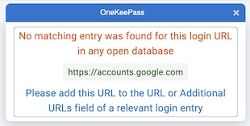
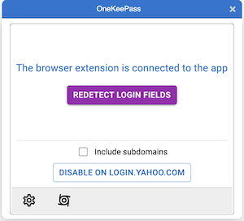
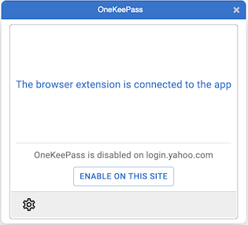
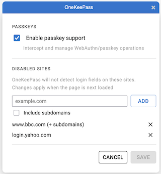

# OneKeePass Browser Extension - User Guide

OneKeePass Browser is a browser extension for Chrome and Firefox that connects to the OneKeePass desktop password manager running on your computer. It provides password autofill for login pages and passkey (WebAuthn/FIDO2) support for passwordless authentication.

## Prerequisites

- **OneKeePass desktop application** installed on your computer (macOS, Linux, or Windows)
- **Supported browser**: Google Chrome, Brave or Mozilla Firefox
- The desktop application must be **running** with at least one KeePass database open whenever you use the extension

## Setup

### Step 1: Enable Browser Extension Support in the Desktop App

1. Open the OneKeePass desktop application
2. Go to the application **Settings**
3. Enable **Browser Extension Support**
4. Select the browsers you want to allow (Firefox, Chrome, or both)

This writes the necessary configuration so your browser can communicate with the desktop app. You only need to do this once per browser.

### Step 2: Install the Browser Extension

- **Chrome**: Install "OneKeePass-Browser" from the Chrome Web Store
- **Brave**: Install "OneKeePass-Browser" from the Chrome Web Store
- **Firefox**: Install "OneKeePass-Browser" from Firefox Add-ons

### Step 3: Approve the Connection

1. After installing the extension, navigate to any web page
2. Click the OneKeePass extension icon in your browser toolbar
3. The extension will attempt to connect to the desktop app
4. You will see a message: *"OneKeePass browser is ready to use the OneKeePass App. Please check the OneKeePass App for association request"*
5. Click **Continue** in the extension popup
6. Switch to the OneKeePass desktop application -- you will see a connection approval request
7. **Approve** the request in the desktop app
8. The extension will now show: *"The browser extension is connected to the app"*

This approval is a one-time step. The pairing is remembered for future sessions.

## Using Password Autofill

### How It Works

When you navigate to a login page, the extension automatically detects username and password fields. A small OneKeePass icon appears inside the detected input fields. The extension matches the current website's URL against entries stored in your open KeePass database(s).

### Filling Credentials

1. Click on a username or password input field
2. A popup appears showing matching entries from your open database(s)
   - Entries are grouped by database name if multiple databases are open
   - Each entry shows its title and username
3. Click the entry you want -- the username and password fields are filled automatically

### When No Matches Are Found

If no entry matches the current URL, you will see:

> *"No matching entry was found for this login URL in any open database"*

To pick the credentials for a site, please add the URL to the **URL or Additional URLs** field of a relevant login entry in a keepass database

## Using Passkeys (WebAuthn/FIDO2)

Passkeys are a modern passwordless sign-in method. OneKeePass can store and use passkeys directly from your KeePass database, acting as a passkey provider.

### Enabling or Disabling Passkey Support

Passkey support is **enabled by default**. To toggle it:

1. Click the OneKeePass extension icon in the browser toolbar
2. Click the **Settings** icon (gear) in the popup footer
3. Check or uncheck **Enable passkey support**
4. Click **Save** to apply

### Registering a New Passkey

When a website asks you to create a passkey, OneKeePass intercepts the request and shows a "Save Passkey" popup that guides you through these steps:

1. **Select database** -- choose which open database to store the passkey in (auto-selected if only one is open)
2. **Choose group** -- pick an existing group or create a new one
3. **Choose entry** -- pick an existing entry or create a new one to store the passkey
4. Click **Save Passkey** to complete

You will see a *"Passkey saved!"* confirmation. You can cancel at any step.

### Signing In with a Passkey

When a website requests passkey authentication:

1. OneKeePass shows a popup listing matching passkeys from your open database(s)
2. Select the passkey you want to use
3. The extension handles the rest of the authentication automatically

If no matching passkeys are found, a message will inform you that no saved passkeys were found for the site.

## Disabling OneKeePass on Specific Sites

By default OneKeePass scans every page you visit for login fields. If you would rather it stay completely out of the way on certain sites (for example, a site whose own form handling conflicts with autofill), you can disable it per site. On a disabled site OneKeePass does **not** scan for or detect login fields, so no field icons or entry popups appear.

Disabling a site affects **login-field detection only**. Passkey support is controlled separately by the **Enable passkey support** setting and is not changed when you disable a site.

### Quick Disable from the Popup

The fastest way to disable the current site:

1. Click the OneKeePass extension icon in the browser toolbar
2. In the popup, find the **Disable on this site** control
3. Optionally tick **Include subdomains** to also cover every subdomain of the site (for example, disabling `example.com` with this option also covers `login.example.com`)
4. Click **Disable on `<site>`**

The page reloads and OneKeePass stops detecting login fields there.

When you open the popup on a site that is already disabled, it shows that the site is disabled (and whether subdomains are included) with an **Enable on this site** button to turn detection back on. The **Redetect** action is hidden while a site is disabled, since detection is off.

### Managing Disabled Sites in Settings

You can review and edit the full list of disabled sites:

1. Click the OneKeePass extension icon, then the **Settings** icon (gear) in the popup footer
2. Under **Disabled Sites**, you will see every site you have disabled
3. To add one, type a host (for example, `example.com`), optionally tick **Include subdomains**, and click **Add**
4. To remove one, click the **✕** next to it
5. Click **Save** to apply your changes

Changes made in Settings take effect the next time the affected page is loaded.

## Extension Popup Actions

When you click the OneKeePass icon in the browser toolbar, the popup provides these actions:

| Icon | Action | Description |
|------|--------|-------------|
| Gear | **Settings** | Opens the extension settings panel (passkey support and disabled sites) |
| Cyclone | **Redetect** | Rescans the page for login fields. Useful when a page loads content dynamically (e.g., a login form appears after clicking a button). Hidden when the current site is disabled |

The popup also shows a **Disable on this site** / **Enable on this site** control for managing the current site (see [Disabling OneKeePass on Specific Sites](#disabling-onekeepass-on-specific-sites)).

If the desktop app is not running or the connection is lost, a **Connect** button appears to re-establish the connection.

## Troubleshooting

### "Please install the latest platform specific OneKeePass App"

- Make sure the OneKeePass desktop application is installed
- Enable **Browser Extension Support** in the desktop app settings and select the correct browser
- Restart the browser after enabling browser support for the first time

### "There is no connection to the locally installed app. The app may not be running."

- The desktop application must be running for the extension to work
- Start the OneKeePass desktop app, then click the **Connect** button in the extension popup

### "User rejected connecting with OneKeePass App"

- The association request was declined in the desktop app
- Click the extension icon again and when prompted, approve the connection in the desktop app

### "Please open a browser connection enabled database and then try"

- Open a KeePass database in the OneKeePass desktop app before using the extension

### "No matching entry is found for this login url"

- Check that the website URL is stored in the entry's URL field in your KeePass database
- The extension matches entries based on URL -- if the stored URL does not match the current page, no entries will appear

### Extension does not detect login fields

- Check that the site is not disabled. Click the extension icon -- if it shows **OneKeePass is disabled on this site**, click **Enable on this site**. You can also review the full list under **Settings → Disabled Sites** (see [Disabling OneKeePass on Specific Sites](#disabling-onekeepass-on-specific-sites))
- Some websites use non-standard login forms that may not be detected automatically
- Click the extension icon and use the **Redetect** button (cyclone icon) to rescan the page
- If the login form appeared dynamically after page load, try the Redetect button after the form is visible
